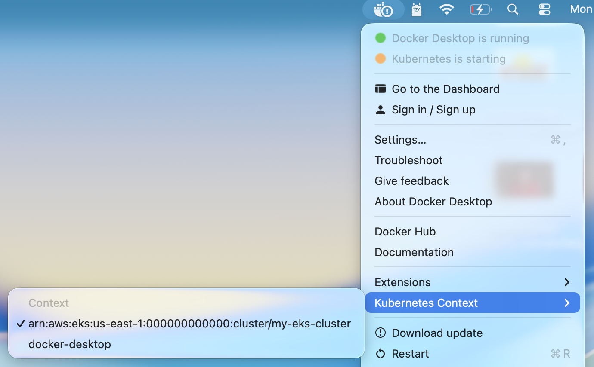

# Kubernetes

## What features do orchestration tools offer ?
1. High Availability or no downtime
2. Scalability or high performance
3. Disaster recovery -  backup and restore

Website can run with latest state after data recovery 

---

## Main kubernetes components
- Pod
- Volumes
- Service
- Ingress
- Secrets
- Statefulset
- ConfigMap
- Deployment

### 1. Pod
Smallest unit of K8s
Abstraction over container : it create layer top of container (docker container)
Usually 1 application per Pod 
Each Pod gets its own IP address : each pod communicate using IP address
New IP address on re-creation
For example My-app and db inside this two pod both two containers in on Node 1, in case db crash it will automatic create new one in place of that with new IP, so as new ip on re creation so we use service component to manage this.

### 2. Service
Permanent IP address
Lifecycle of Pod and Service not connected, so in case new db pod created service will hold old IP address to connect with others 
External service : http://124.89.101.2:8080
Internal service : http://db-service-ip:port
Work as load balancer : it catch the request and forward it to which ever pod least busy 


### 3. Ingress
To open service with domain we have ingress component 
https://My-app.com

### 4. ConfigMap
My-app (pod 1) using mongo-db-service (pod 2), Database Url usually in the built application, for example if end point (name ) of mongo-db-service change to mongo-db then in this case we need to re build new version, push it to repo, pull it in your pod and start everything. So for resolve this small change we have configMap. This is like 
external configuration of your application
For example DB_URL = mongo-db

Don’t put credentials into ConfigMap in plan text because it will in insecure, Like db username and password, so resolve this K8s have another component called Secret

### 5. Secret 
Used to store secret data
Base64 encoded 
This built-in security mechanism is not enabled by default
Use it as environment variables

### 6. Volumes
In case of database container or pod restarted data will be gone. We need our database data or log data persistence   
Volumes attach physical data on hard drive to your pod, it can be storage on local machine or remote which outside of the K8s cluster it could be cloud storage or own storage which not part of K8s cluster
K8s doesn’t manager data persistance, so admin or user need to make proper backup of data 

### 7. Deployment 
Blueprint for my-app pods
You create deployments instead of duplicate pod
Here we decide how many replica we need, also scale up and scale down number of pods we need
Abstraction of Pods 
Replicate everything
In case one pod down we have replicate node which have exact copy of node 
Node 1 : my-app and db
Node 2 : my-app 

We can not replicate db via Deployment because database has state which is data, so deployment for stateLESS Apps

for example which pod reading and which pod writing, so we need shared db, so we have K8s StatefulSet component 

### 8. StatefulSet
For Stateful apps like : mongodb, mysql, elastic search or any other stateful application 
Deploying StatefulSet not easy that is why Db are often hosted outside of K8s cluster

There are more K8s component but these are the main component mostly used. 

---

## K8s Architecture explained
### Node : Worker machine in K8s cluster like a AWS EC2 instance.
##### Each node has multiple Pods on it for example my-app pod and db pod
##### 3 processes must be installed on every Node like 
1. **container runtime** need to install on every node, 
2. **Kubelet** which schedule pods in container, Kubelet interacts with both container and node, Kubelet starts the pod with a container inside, assign resources from node to container  
3. **Kobe Proxy** which forwards the requests, it manage which request forward to where, for example my-app should first send db request to same node db pod instead of replica node

### Cluster :  it can have multiple Nods inside 

How do you interact with this cluster ?
How to : 
- schedule pod ?
- Monitor ?
- Re-schedule/re-start pod ?
- Join a new node ?

Answer is **Master Processes** or **Master server** or **Master node**

#### Master Processes
4 processes run on every master node
1. **Api server** which is used to interact with client (Ui, K8s dashboard, Cmd tool, K8s api), so Api server is like cluster gateway which get initial request of update/query in cluster, its acts as a gatekeeper for authentication 
2. **Scheduler** : for schedule new pod it work like api server > scheduler > start new pod in worker (node), it also check where to put the Pod, in least used pod it will create new pod, so Scheduler just decides on which Node new pod should be scheduled 
3. **Controller manager** : detects cluster state changes for example pods down in nodes so it will detect and try to recover cluster state as soon as possible, it will send request to scheduler which decide where to add new pods 
4. **etcd** : it key value store of cluster, etcd is the cluster brain. Every change in cluster get stored in the key value store, everything in cluster work with this etcd data, actual application data is not stored in etcd, it store cluster information like which node is least used etc. 
 

#### Master node need less resources like CPU | RAM | STORAGE 

##### Example Cluster Set-Up
2 Master Nodes
3 Worker Nodes    


### What is minikube ?
It is used to Test Cluster Setup or Local Cluster Setup
Master and node precesses run on One machine 
1. Creates virtual box on your laptop
2. Node runs in that virtual box
3. 1 node K8s cluster
4. For testing purposes 

### What is kubectl ?
Now as you have local node in your virtual machine using minikube, you need some way to interact with cluster for create pods and other K8s components, so we can do this using Kubectl. Kubectl is command line tool for K8s cluster 

As you know to interact with Api server in master processes we need client, so KubeCtl is CLI client 
Kubectl is not just for mnikube cluster, it can be use with Cloud cluster or Hybrid cluster, so it is for interact with any type of K8s cluster setup 

---

## First see some kubernates commands
<span style="color:blue">Get List of clusters exists or configured in your pc</span>
```
kubectl config get-contexts
```
**Output**
```
CURRENT   NAME                                                          CLUSTER                                                     NAMESPACE
*         arn:aws:eks:us-east-1:000000000000:cluster/my-eks-cluster     same as name                                                same as name  
          docker-desktop                                                docker-desktop                                              docker-desktop    
```

> [!NOTE]
> I used "same as name" to fit above output in md file otherwise it was same arn:aws:eks:us-east-1:000000000000:cluster/my-eks-cluster 
> You can see its showing CURRENT * for my-eks-cluster which i created using floci local emulator.

<span style="color:blue">We can also use below command to see current context instead of get all list</span>
```
kubectl config current-context
```
**Output**
```
arn:aws:eks:us-east-1:000000000000:cluster/my-eks-cluster
```

<span style="color:blue">Get cluster information</span>
```
kubectl cluster-info
```

<span style="color:blue">Then check which API server URL your active context uses:</span>
```
kubectl config view --minify
```

Look for a line similar to:
```
clusters:
- cluster:
    server: https://localhost:6500
```

<span style="color:blue">For local learning we should use docker desktop, so switch on it:</span>
```
kubectl config use-context docker-desktop
```

<span style="color:blue">We can also switch context using docker ui</span>


#### Basic kubectl commands
<span style="color:blue">Get nodes list</span>
```
kubectl get nodes
```
**Output**
```
NAME             STATUS   ROLES           AGE   VERSION
docker-desktop   Ready    control-plane   15d   v1.34.1
```

<span style="color:blue">Get pods list</span>
```
kubectl get pods
```

<span style="color:blue">Get services list</span>
```
kubectl get services
```

#### Kubectl create command
Using kubectl create command, we can create different components
```
kubectl create -h
```
**Output**
```
Create a resource from a file or from stdin.

 JSON and YAML formats are accepted.

Examples:
  # Create a pod using the data in pod.json
  kubectl create -f ./pod.json
  
  # Create a pod based on the JSON passed into stdin
  cat pod.json | kubectl create -f -
  
  # Edit the data in registry.yaml in JSON then create the resource using the edited data
  kubectl create -f registry.yaml --edit -o json

Available Commands:
  clusterrole           Create a cluster role
  clusterrolebinding    Create a cluster role binding for a particular cluster role
  configmap             Create a config map from a local file, directory or literal value
  cronjob               Create a cron job with the specified name
  deployment            Create a deployment with the specified name
  ingress               Create an ingress with the specified name
  job                   Create a job with the specified name
  namespace             Create a namespace with the specified name
  poddisruptionbudget   Create a pod disruption budget with the specified name
  priorityclass         Create a priority class with the specified name
  quota                 Create a quota with the specified name
  role                  Create a role with single rule
  rolebinding           Create a role binding for a particular role or cluster role
  secret                Create a secret using a specified subcommand
  service               Create a service using a specified subcommand
  serviceaccount        Create a service account with the specified name
  token                 Request a service account token
```

<span style="color:blue">Let's create a deployment for ngnix image</span>
```
kubectl create deployment ngnix-depl --image=ngnix
```
here ngnix-depl is deployment name which we provided as configuration option.

**Output**
```
deployment.apps/ngnix-depl created
```

<span style="color:blue">Get deployments list</span>
```
kubectl get deployment
```
**Output**
```
NAME         READY   UP-TO-DATE   AVAILABLE   AGE
ngnix-depl   0/1     1            0           69s
```

Now if you run `kubectl get pods`, it will show one pod, because deployment create pods with replicaset, as we did not set replica, so it will be only one pod

<span style="color:blue">Get replica set list</span>
```
kubectl get replicaset
```
**Output**
```
NAME                    DESIRED   CURRENT   READY   AGE
ngnix-depl-79955cd7f6   1         1         0       5m43s
```

<span style="color:blue">Let's edit above deployment</span>
Just use edit instead of create and provide deployment name
```
kubectl edit deployment ngnix-depl
```
Above command will open deployment configution file in `vi` editor in terminal, so you can press Esc then :wq for save once change image or anything

Now if you do `kubectl get pods` it will show list as below
```
NAME                          READY   STATUS        RESTARTS   AGE
ngnix-depl-67c59bfc5-27fc4    1/1     Running       0          12s
ngnix-depl-79955cd7f6-lwtkz   0/1     Terminating   0          17m
```

#### Debugging pods
We can use below commands for debug pods
```
kubectl logs <POD_NAME>
kubectl describe pod  <POD_NAME>
kubectl exec -it <POD_NAME> -- bin/bash
kubectl exec -it <POD_NAME> sh
```


<span style="color:blue">Delete deployments list</span>
```
kubectl delete deployment ngnix-depl
```
**Output**
```
deployment.apps "ngnix-depl" deleted from default namespace
```
Above command will also delete pods and replica Set linked with this deployment.

#### We did CRUD operation using cli, but in practical, We use yaml configuration file and apply using kubectl apply -f command.

##### For more details about pods and services, see power point file in cheetsheet folder.

<span style="color:blue">Get all resources created in cluster</span>
```
kubectl get all
```
**Output**
```
NAME                 TYPE        CLUSTER-IP   EXTERNAL-IP   PORT(S)   AGE
service/kubernetes   ClusterIP   10.96.0.1    <none>        443/TCP   16d
```
We have only one default kubernetes service, means we did not created anything yet.

Let's again create a deployment for redis using yaml and see what we get with `kubectl get all`

<span style="color:blue">Create `redis-depl.yaml` file with below configuration</span>
```
apiVersion: apps/v1
kind: Deployment
metadata:
  labels:
    app: redis-depl
  name: redis-depl
spec:
  replicas: 2
  selector:
    matchLabels:
      app: redis-depl
  template:
    metadata:
      labels:
        app: redis-depl
    spec:
      containers:
      - image: redis
        name: redis
```
<span style="color:blue">Let's create deployment using `redis-depl.yaml` file</span>
```
kubectl apply -f redis-depl.yaml
```
**Output**
```
deployment.apps/redis-depl created
```

<span style="color:blue">Run get all command</span>
```
kubectl get all
```
**Output**
```
NAME                 TYPE        CLUSTER-IP   EXTERNAL-IP   PORT(S)   AGE
service/kubernetes   ClusterIP   10.96.0.1    <none>        443/TCP   16d

NAME                             READY   STATUS    RESTARTS   AGE
pod/redis-depl-9c899fd57-prrlh   1/1     Running   0          28s

NAME                         READY   UP-TO-DATE   AVAILABLE   AGE
deployment.apps/redis-depl   1/1     1            1           29s

NAME                                   DESIRED   CURRENT   READY   AGE
replicaset.apps/redis-depl-9c899fd57   1         1         1       28s
```

You may notice deployment created three things `pod, deployment, replicaset`. For now we created deployment using cli command, but as a good practice we should create it using yml configuration file. You may think how deployment manage current state and desired stat ? like we need 2 pod and if have only one pod then create a new one and keep track it ? for this kubernetes have etcd key-value database. We can get deployment configuration details and save in a file to see. run below command.

<span style="color:blue">Below command will show all configuration in terminal</span>
```
kubectl get deployment redis-depl -o yaml
```

<span style="color:blue">Let's save this in a yaml file</span>
```
kubectl get deployment redis-depl -o yaml > redis-depl-result.yaml
```
Above command will create a new `redis-depl-result.yaml` file, you may notice in `redis-depl.yaml` we have only 19 lines but in `redis-depl-result.yaml` we have 63 lines. Because in this we also have default settings which we did not set for deployment and pod, also a new status configuration which is used to manage current stat and desired stat.
