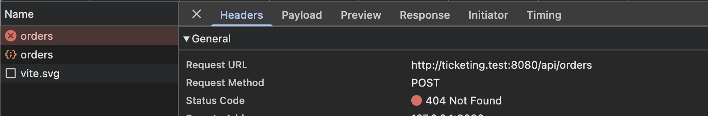

## Let's update way of using Secret and ConfigMap
Previously we created `secret-encoded.yaml` file for `secrets` and `common-config.yaml` file for `ConfigMap`.
In real production application we can have hundered of application configuration and secrets. Setting all one by one in env is not best practice and required extra effert. For example see below : 

```
env:
  - name: NATS_CLIENT_ID
    valueFrom:
      fieldRef:
        fieldPath: metadata.name
  - name: NATS_URL
    valueFrom:
      configMapKeyRef:
        name: app-configuration
        key: NATS_URL
  - name: NATS_CLUSTER_ID
    valueFrom:
      configMapKeyRef:
        name: app-configuration
        key: NATS_CLUSTER_ID
  - name: MONGO_URI
    valueFrom:
      configMapKeyRef:
        name: app-configuration
        key: MONGO_URI_TICKETS
  - name: JWT_KEY
    valueFrom:
      secretKeyRef:
        name: my-app-secret
        key: JWT_KEY
```

So instead of `env:` we can use `envFrom:`, in `envFrom` we can pass `secet` or `configMap` name. see example below
```
envFrom:
  - configMapRef:
      name: app-configuration
  - secretRef:
      name: my-app-secret
```

Now you may have two `Questions`:
1. in `app-configuration` we have `REDIS_HOST` key which required by only `expiration` service, So there can be a case when you don't need all configuration in a deployment.
**Answer :** For this we can split `common-config.yaml` file `app-configuration` into multiple files and create multiple configuration like `common-config, frontend-config` etc. Then we can use multiple `configMapRef` in deployments.
2. We have a `NATS_CLIENT_ID` environment variable which using `fieldRef` for deployment `metadata.name`
**Answer :** We can use `env:` and `envFrom:` both together in deployments.


> [!NOTE]
> I have copied stage2 project yaml files into stage3 and will change them now for improvements

<span style="color:blue">First delete everything</span>
```
cd stage3
kubectl delete -f .
```

### Organize files as per type in sub folders.
Instead of keep all files in stage3 folder root, We should create sub folders like `configmaps`, `secrets`, `deployments`

<span style="color:blue">Create `configmaps` folder in stage3 folder and move `common-config.yaml` into it</span>
<span style="color:blue">Create `secrets` folder in stage3 folder and move `secret-encoded.yaml` into it</span>
<span style="color:blue">Create `deployments` folder in stage3 folder and move remaining files into it</span>

<span style="color:blue">Create a file named `nats-config.yaml` in `stage3/configmaps` folder.</span>
```
apiVersion: v1
kind: ConfigMap
metadata:
  name: nats-configuration
  namespace: default
data:
  NATS_URL: "nats://nats-srv:4222"
  NATS_CLUSTER_ID: ticketing
```

<span style="color:blue">Create a file named `redis-config.yaml` in `stage3/configmaps` folder.</span>
```
apiVersion: v1
kind: ConfigMap
metadata:
  name: redis-configuration
  namespace: default
data:
  REDIS_HOST: expiration-redis-srv
```

<span style="color:blue">As now nats and redis environment variables added in seperate files, we will remove them from `common-config.yaml`</span>
```
apiVersion: v1
kind: ConfigMap
metadata:
  name: app-configuration
  namespace: default
data:
  MONGO_URI_AUTH: "mongodb://mongo-srv:27017/auth"
  MONGO_URI_ORDERS: "mongodb://mongo-srv:27017/orders"
  MONGO_URI_PAYMENTS: "mongodb://mongo-srv:27017/payments"
  MONGO_URI_TICKETS: "mongodb://mongo-srv:27017/tickets"
```


<span style="color:blue">Create a file named `stripe-secret.yaml` in `stage3/secrets` folder.</span>
```
apiVersion: v1
kind: Secret
metadata:
  name: my-stripe-secret
  namespace: default
type: Opaque
data:
  STRIPE_KEY: c2tfdGVzdF9obmZyQW04ck9rcnlGRW5WMjNqamZGbHc=
```
<span style="color:blue">As now stripe environment variable added in seperate files, we will remove that from `secret-encoded.yaml`</span>
```
apiVersion: v1
kind: Secret
metadata:
  name: my-app-secret
  namespace: default
type: Opaque
data:
  JWT_KEY: bXlfc3VwZXJfc2VjcmV0X2tleQ==
```

### Let's update deployments files to use env and envFrom together
#### 1. updated `auth-depl.yaml` as below:
```
...
image: ticketing-nats-auth-app:1.2
envFrom:
  - secretRef:
      name: my-app-secret
env:
  - name: MONGO_URI
    valueFrom:
      configMapKeyRef:
        name: app-configuration
        key: MONGO_URI_AUTH
```

#### 2. updated `expiration-depl.yaml` as below:
```
...
image: ticketing-nats-expiration-app:1.2
envFrom:
  - configMapRef:
      name: nats-configuration
  - configMapRef:
      name: redis-configuration
env:
  - name: NATS_CLIENT_ID
    valueFrom:
      fieldRef:
        fieldPath: metadata.name

```

#### 3. updated `orders-depl.yaml` as below:
```
...
image: ticketing-nats-orders-app:1.2
envFrom:
  - configMapRef:
      name: nats-configuration
  - secretRef:
      name: my-app-secret
env:
  - name: NATS_CLIENT_ID
    valueFrom:
      fieldRef:
        fieldPath: metadata.name  
  - name: MONGO_URI
    valueFrom:
      configMapKeyRef:
        name: app-configuration
        key: MONGO_URI_ORDERS

```

#### 4. updated `payments-depl.yaml` as below:
```
...
image: ticketing-nats-payments-app:1.2
envFrom:
  - configMapRef:
      name: nats-configuration
  - secretRef:
      name: my-app-secret
  - secretRef:
      name: my-stripe-secret
env:
  - name: NATS_CLIENT_ID
    valueFrom:
      fieldRef:
        fieldPath: metadata.name
  - name: MONGO_URI
    valueFrom:
      configMapKeyRef:
        name: app-configuration
        key: MONGO_URI_PAYMENTS
```

#### 5. updated `tickets-depl.yaml` as below:
```
...
image: ticketing-nats-tickets-app:1.2
envFrom:
  - configMapRef:
      name: nats-configuration
  - secretRef:
      name: my-app-secret
env:
  - name: NATS_CLIENT_ID
    valueFrom:
      fieldRef:
        fieldPath: metadata.name
  - name: MONGO_URI
    valueFrom:
      configMapKeyRef:
        name: app-configuration
        key: MONGO_URI_TICKETS
```

### Let's apply configuration files and test application

<span style="color:blue">Apply configMap and after that secret</span>
```
cd stage3
kubectl apply -f configmaps/
```
**Output**
```
configmap/app-configuration created
configmap/nats-configuration created
configmap/redis-configuration created
```

```
kubectl apply -f secrets/
```
**Output**
```
secret/my-app-secret created
secret/my-stripe-secret created
```
<span style="color:blue">Now apply all deployments</span>
```
kubectl apply -f  deployments/
```

<span style="color:blue">Let's see all pods status after 10 seconds</span>
```
kubectl get pods
```

**Output**
```
NAME                                     READY   STATUS    RESTARTS      AGE
auth-depl-564f4fcb68-767sk               1/1     Running   0             39s
client-depl-6f9c6f8946-xvcdv             1/1     Running   0             39s
expiration-depl-ccbff88db-zbxf7          1/1     Running   1 (28s ago)   39s
expiration-redis-depl-56c5cd8cf6-947dm   1/1     Running   0             39s
mongo-app-depl-77d6f75958-bnrkb          1/1     Running   0             39s
nats-depl-6468fdb94d-cdjfl               1/1     Running   0             39s
orders-depl-85bf69756d-d94wj             1/1     Running   0             39s
payments-depl-6bcd478779-x25hb           1/1     Running   0             39s
tickets-depl-7945df8d4-77l75             1/1     Running   0             38s
```
As per our configuration, We need one instance for each pod and as per above output we have it ready and running, 

#### port forward ingress controller as in our local pc port 80 used by apache
```
kubectl port-forward -n ingress-nginx svc/ingress-nginx-controller 8080:80
```

#### Open website and unit test
```
http://ticketing.test:8080
```
#### Let's create a ticket and purchase it
When i tried to purchase a ticket, order api failed see below


`Why order api return 404 ?`

So as per above pod status for `orders`, its ready and running, means kubenetes can not handle it.

<span style="color:blue">Let's see logs of orders pod</span>

```
kubectl logs orders-depl-85bf69756d-d94wj
```
**Output**

```
Listening on port 3003
NATS connection failed: NatsError: Could not connect to server: Error: connect ECONNREFUSED 10.97.200.104:4222
    at Socket.<anonymous> (/app/node_modules/nats/lib/nats.js:833:26)
    at Socket.emit (node:events:524:28)
    at emitErrorNT (node:internal/streams/destroy:169:8)
    at emitErrorCloseNT (node:internal/streams/destroy:128:3)
    at process.processTicksAndRejections (node:internal/process/task_queues:82:21) {
  code: 'CONN_ERR',
  chainedError: Error: connect ECONNREFUSED 10.97.200.104:4222
      at TCPConnectWrap.afterConnect [as oncomplete] (node:net:1611:16) {
    errno: -111,
    code: 'ECONNREFUSED',
    syscall: 'connect',
    address: '10.97.200.104',
    port: 4222
  }
}
Connected to MongoDB
```

As per above logs, application connected with mongodb, but did not connected with nats streaming server. 

Its because when we apply all `deployments` which include `nats` and `mongo` as well. There can be a chance orders pod start and ready before `mongo` or `nats` stats running. So when orders tried to connect it failed due to `nats` not ready. 

Maybe you think why `mongo` connected ? its because in applicaiton code, I used `try` `catch` and in `catch` i used setTimout with 5 seconds to retry to connect that's why its working.

Right now this nats connection issue with all application pods. For quick

#### Let's quick fix nats connection issue
As we are using kubenetes, So if we will delete a pod, it will automatic create a new pod. This is the power of `Self-Healing`

<span style="color:blue">Below command will delete orders pod</span>
```
kubectl delete pod orders-depl-85bf69756d-d94wj
```
**Output**
```
pod "orders-depl-85bf69756d-d94wj" deleted from default namespace
```

<span style="color:blue">Let's see orders pod re created or not</span>
```
kubectl get pods | grep '^orders'
```
**Output**
```
orders-depl-85bf69756d-xhc9w             1/1     Running   0             9m7s
```
You can see its a new `pod` because pod id changed from `d94wj` to `xhc9w` 

<span style="color:blue">Let's see logs of orders pod</span>

```
kubectl logs orders-depl-85bf69756d-xhc9w
```
**Output**
```
Listening on port 3003
Connected to NATS
Connected to MongoDB
Message received: ticket:created / orders-service
```

Now you can see its fixed, so for a quick fix we need to do for other remaining application pods as well

**Next we will use a production level approach to fix it**